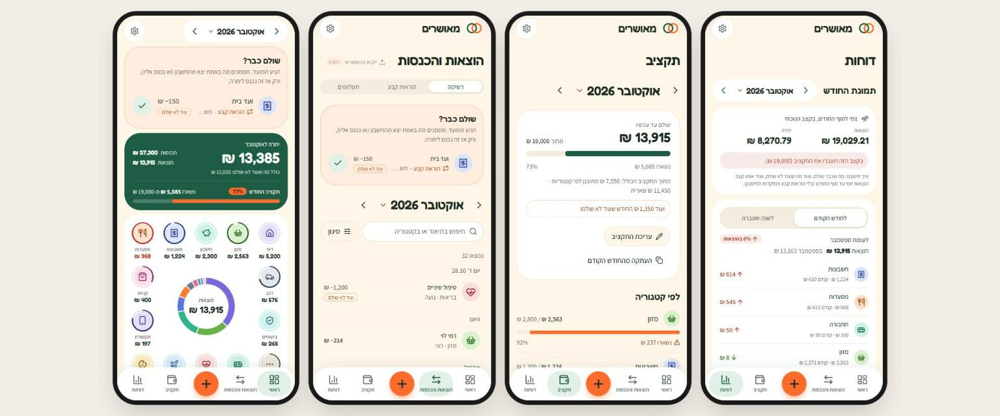
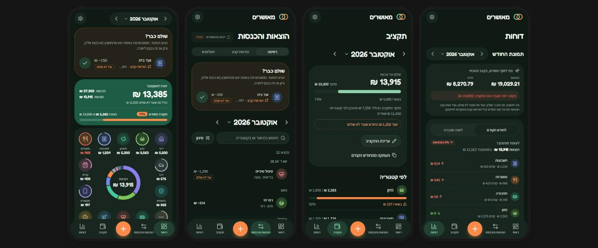
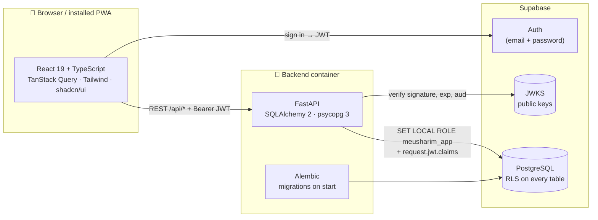
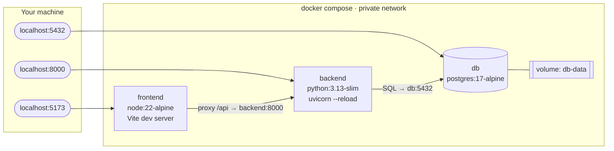

<div align="center">

# מאושרים · Meusharim

**A shared budget app for couples: Hebrew, right-to-left, mobile-first.**

Two partners log income and expenses into one household ledger, set monthly budgets,
track recurring bills, installments and savings goals, and see where the money goes.

[**Live app →**](https://meusharim.onrender.com)


</div>



<details>
<summary><b>Dark mode</b></summary>



</details>


<sub>Screenshots use an invented demo household; no real data.</sub>

---

<div dir="rtl">

## בקצרה

**מאושרים** היא אפליקציית תקציב משותפת לזוג. שני בני הזוג רושמים הוצאות והכנסות לאותו
משק בית, מגדירים תקציב חודשי לכל קטגוריה, ורואים בכל רגע כמה נשאר עד סוף החודש.

- **הוספה מהירה:** לוחצים על עיגול של קטגוריה, מקלידים סכום, וזהו.
- **שולם / עוד לא שולם:** רק מה שבאמת יצא מהחשבון נספר. מה שמתוכנן מוצג בנפרד.
- **הוראות קבע ותשלומים:** שכר דירה, מנויים או ספה ב-12 תשלומים נכנסים לבד בכל חודש.
- **תקציב והתראות:** טבעת סביב כל קטגוריה מראה כמה מהתקציב נוצל. ב-80% מופיעה התראה.
- **יעדי חיסכון ודוחות:** השוואה לחודש הקודם או לאותו חודש בשנה שעברה, וצפי לסוף החודש.
- **זוגי באמת:** מזמינים את בן או בת הזוג בקישור חד-פעמי, ושניכם רואים ומנהלים הכול.
- **בטלפון:** אפשר להתקין כאפליקציה (PWA), עם מצב כהה וסיור מודרך בכניסה הראשונה.

</div>

---

## Highlights

| Feature | Details |
|---|---|
| **Fully containerized** | One `docker compose up` starts PostgreSQL, the FastAPI backend and the Vite frontend, with health checks, hot reload and automatic migrations. The production backend is the same Docker image. |
| **Database-level security** | Every request runs as a dedicated Postgres role under **Row Level Security**, so one household can never read another's data even if application code has a bug. |
| **Correct money** | Amounts are `NUMERIC(12,2)` / Python `Decimal` end to end and travel as strings. The frontend never does floating-point math on money. |
| **One ledger** | Manual entries, recurring payments, installments and savings deposits all live in one `transactions` table with an explicit `planned` / `completed` status. |
| **Tested** | 318 backend tests (pytest, against a real PostgreSQL) and 98 frontend tests (Vitest), including cross-household authorization and RLS tests. |

---

## Architecture



- **Modular monolith.** One FastAPI app split by domain (`households`, `categories`,
  `transactions`, `schedules`, `budgets`, `goals`, `summary`, `reports`, `imports`, `account`),
  each with its own `router` → `service` → `schemas`. No microservices.
- **The frontend talks to Supabase only to sign in.** All data goes through the FastAPI
  REST API; Supabase's own Data API roles have no privileges on app tables.
- **Platform-neutral.** Environment differences are environment variables only, so the
  same code runs in Docker locally and on Render + Supabase in production.

---

## 🐳 Docker and containers

The whole development environment is defined in [`compose.yaml`](compose.yaml): three
services on one private network, started with one command.



```text
$ docker compose ps
SERVICE    IMAGE                STATUS                  PORTS
backend    meusharim-backend    Up 17 hours             0.0.0.0:8000->8000/tcp
db         postgres:17-alpine   Up 17 hours (healthy)   0.0.0.0:5432->5432/tcp
frontend   meusharim-frontend   Up 17 hours             0.0.0.0:5173->5173/tcp
```

What the setup does:

| Technique | Where | Why |
|---|---|---|
| **Health-checked startup order** | `db.healthcheck` runs `pg_isready`; `backend.depends_on: condition: service_healthy` | The backend never starts against a database that is not ready to accept connections. |
| **Migrations on container start** | backend `command` / [`start.sh`](backend/start.sh): `alembic upgrade head`, then uvicorn | The schema is always current; a fresh clone needs no manual DB steps. |
| **Service discovery by name** | `DATABASE_URL=…@db:5432`, `API_PROXY_TARGET=http://backend:8000` | Containers reach each other by service name on Compose's internal network. |
| **Live reload in containers** | Bind mounts `./backend:/app`, `./frontend:/app`; `WATCHFILES_FORCE_POLLING`, `WATCH_POLLING` | Editing code on the host reloads the running container (polling, because Docker Desktop on Windows/macOS does not forward file events). |
| **Isolated `node_modules`** | Anonymous volume `/app/node_modules` | The Linux dependencies inside the image are not overwritten by the host's bind mount. |
| **Persistent data** | Named volume `db-data` | The database survives `docker compose down`; `down -v` resets it. |
| **One Dockerfile, two targets** | [`backend/Dockerfile`](backend/Dockerfile), build arg `INSTALL_DEV` | Development adds test and lint tools; production installs runtime dependencies only. |
| **Non-root container** | `useradd appuser` + `USER appuser` | The API process does not run as root. |
| **Small, cache-friendly images** | `*-slim` / `*-alpine` bases; dependency files copied before the source | Dependency layers are rebuilt only when requirements change. |
| **Required config fails fast** | `${SUPABASE_URL:?Set SUPABASE_URL in .env}` | Compose refuses to start with a clear message instead of a half-configured stack. |
| **Same image in production** | Render builds `backend/Dockerfile` and runs `start.sh` on `$PORT` | What runs locally is what runs in production. |

---

## Security, in depth

- **JWT verification.** FastAPI validates every access token against the Supabase project's
  **JWKS** (signature, `exp`, `aud`). Tests sign their own tokens with a test key through a
  dependency override; no runtime setting makes the backend accept a test key.
- **Row Level Security that actually applies.** Each request opens a transaction, runs
  `SET LOCAL ROLE meusharim_app` and sets `request.jwt.claims` with `set_config(..., true)`.
  Policies call our own `app.current_user_id()` (not Supabase-only `auth.uid()`), so RLS
  behaves the same on local PostgreSQL and on Supabase. `SET LOCAL` ends with the
  transaction, so pooled connections never leak one user's context to the next request.
- **Least privilege.** Grants go to `meusharim_app` only. Supabase's `anon` and
  `authenticated` roles are revoked from every app table.
- **Invitations.** A partner joins through a single-use link that expires after 7 days. Only
  the token's SHA-256 is stored; the token travels in the URL fragment (never sent to the
  server in a URL or written to logs), and lookups are rate-limited per user.
- **Account deletion** needs two confirmations plus the email and password re-checked on
  the server. The Supabase secret key is used for that one call only.
- **Hardening.** Restricted CORS, input validation with Pydantic, `/docs` off in production,
  query parameters hidden from DB error logs, and no secrets in the frontend bundle.

## Engineering decisions

- **Planned vs. completed.** A date passing never completes a transaction. Only completed
  transactions count in balances, budgets and reports; planned amounts are always shown
  separately ("Paid already?").
- **Schedules without future rows.** Recurring payments and installments never store future
  occurrences. At the start of each household request, due occurrences are written once
  (unique `(schedule_id, sequence_no)` plus a forward-only `next_sequence`); future ones
  are computed on read.
- **Idempotent writes.** Create requests carry a client-generated `request_id` with a unique
  constraint, so a double tap or a retry on a flaky phone connection never creates a duplicate.
- **Budgets.** The monthly total is a ceiling; category budgets cannot add up to more
  (checked on the server). Live form previews use integer agorot (`BigInt`), never floats.
- **Dates.** Months and "today" are interpreted in `Asia/Jerusalem`; dates are stored as `DATE`.
- **Hebrew grammar.** Personal sentences follow each partner's chosen gender (את / אתה),
  stored per member.

---

## Tech stack

| Layer | Technology |
|---|---|
| Frontend | React 19, TypeScript, Vite, Tailwind CSS 4, shadcn/ui (Radix), React Router, TanStack Query, Vitest, oxlint |
| Backend | Python 3.13, FastAPI, Pydantic, SQLAlchemy 2, Alembic, psycopg 3, PyJWT, pytest, Ruff |
| Database | PostgreSQL 17 with Row Level Security (local container; Supabase in production) |
| Auth | Supabase Auth (email + password), JWT verified in FastAPI via JWKS |
| Infrastructure | Docker, Docker Compose, Render (Docker web service + static site), Supabase |
| App | PWA (manifest + service worker), RTL layout, light and dark themes |

## Project structure

```text
meusharim/
├── compose.yaml            # db + backend + frontend for local development
├── backend/
│   ├── Dockerfile          # one image for dev (INSTALL_DEV=true) and production
│   ├── start.sh            # alembic upgrade head → uvicorn
│   ├── migrations/         # Alembic: schema, roles, RLS policies (0001–0011)
│   ├── app/
│   │   ├── main.py         # FastAPI app, routers, CORS
│   │   ├── auth.py         # JWT / JWKS verification
│   │   ├── db.py           # per-request transaction as meusharim_app (RLS)
│   │   ├── schedules/      # recurring + installments engine
│   │   └── …               # one folder per domain: router · service · schemas
│   └── tests/              # pytest against a real PostgreSQL test database
├── frontend/
│   ├── Dockerfile          # Vite dev server
│   ├── public/             # PWA manifest, icons, service worker
│   └── src/                # feature folders: summary, transactions, budgets, goals, reports…
└── docs/                   # deployment guide, plan and progress tracker, screenshots
```

---

## Run locally

Requirements: Docker with Docker Compose.

```bash
cp .env.example .env   # then fill in SUPABASE_PUBLISHABLE_KEY
docker compose up --build
```

`SUPABASE_PUBLISHABLE_KEY` is in the Supabase dashboard of the `meusharim-dev` project
(Project Settings → API Keys). Never use the secret key here.

- Frontend: http://localhost:5173
- Backend health check: http://localhost:8000/api/health
- API docs: http://localhost:8000/docs

The frontend dev server proxies `/api/*` to the backend. Code changes in `frontend/` and
`backend/` reload automatically.

## Database migrations

Alembic migrations live in `backend/migrations/`. The backend container runs
`alembic upgrade head` on startup. To run them manually:

```bash
docker compose exec backend alembic upgrade head
```

## API

All household data goes through FastAPI (locally, `/docs` lists every endpoint; it is off
unless `API_DOCS_ENABLED=true`):

| Area | Endpoints |
|---|---|
| Categories | `GET/POST /api/categories`, `PATCH/DELETE /api/categories/{id}` (delete archives a used category) |
| Transactions | `GET/POST /api/transactions` (filters, search, sort, paging), `PATCH/DELETE /api/transactions/{id}`, `POST /api/transactions/confirm` |
| Recurring and installments | `GET/POST /api/schedules`, `GET/PATCH /api/schedules/{id}`, `POST /api/schedules/{id}/pause|resume|cancel`, `GET /api/schedules/occurrences` |
| Budgets | `GET/PUT /api/budgets?month=YYYY-MM`, `POST /api/budgets/copy-previous?month=` |
| Dashboard | `GET /api/summary?month=YYYY-MM` |
| Reports | `GET /api/reports?from=YYYY-MM&to=YYYY-MM` (up to 60 months) |

The plan and progress of phases 5–9 are in [docs/plan-phases-5-9.md](docs/plan-phases-5-9.md).

## Checks

```bash
# Backend tests and lint (stack must be running; tests use a separate *_test database)
docker compose exec backend pytest -p no:cacheprovider
docker compose exec backend ruff check --no-cache .
docker compose exec backend ruff format --check --no-cache .

# Frontend tests, lint and type-check/build
docker compose exec frontend npm test
docker compose exec frontend npm run lint
docker compose exec frontend npm run build
```

## Deployment

Backend: Render **Docker** web service built from `backend/Dockerfile`. Frontend: Render
static site (`npm ci && npm run build`, publish `dist`). Database and Auth: Supabase.
See [docs/deployment.md](docs/deployment.md) for settings and environment variables.

## Reset the local database

```bash
docker compose down -v
```

---

<sub>Project plan, decisions and working rules: [CLAUDE.md](CLAUDE.md).</sub>
