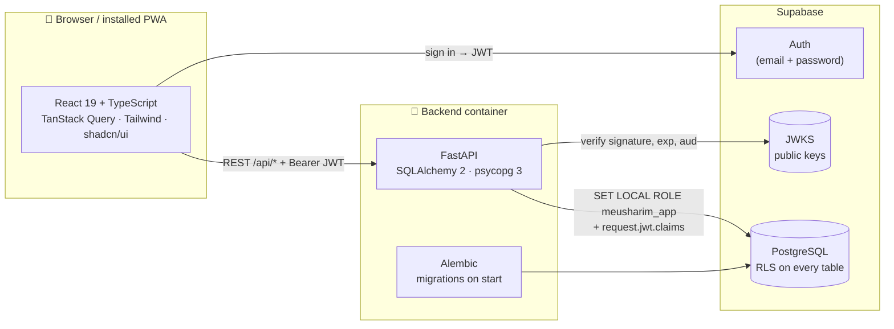

<div align="center">

# מאושרים · Meusharim

**A shared budget app for couples: Hebrew, right-to-left, mobile-first.**

[**Live app →**](https://meusharim.onrender.com)


</div>


<details>
<summary><b>Dark mode</b></summary>


</details>


<sub>Screenshots use an invented demo household.</sub>

## In short

Two partners track income and expenses in one shared household, set a monthly budget per
category and always see how much is left.

- **Quick add:** tap a category circle, type the amount, done.
- **Paid / not paid yet:** only money that actually left the account counts; planned amounts are shown separately.
- **Recurring and installments:** rent, subscriptions or a sofa in 12 payments are added every month automatically.
- **Budgets and alerts:** a ring around each category shows how much of its budget is used, with an alert at 80%.
- **Savings goals and reports:** compare with last month or the same month last year, plus an end-of-month forecast.
- **Built for two:** invite your partner with a one-time link; both see and manage everything.
- **On your phone:** installable (PWA), dark mode and a guided tour on first login.

<details>
<summary><b>בקצרה, בעברית</b></summary>

<div dir="rtl">

**מאושרים** היא אפליקציית תקציב משותפת לזוג. שני בני הזוג רושמים הוצאות והכנסות לאותו
משק בית, מגדירים תקציב חודשי לכל קטגוריה, ורואים בכל רגע כמה נשאר עד סוף החודש.

- **הוספה מהירה:** לוחצים על עיגול של קטגוריה, מקלידים סכום, וזהו.
- **שולם / עוד לא שולם:** רק מה שבאמת יצא מהחשבון נספר. מה שמתוכנן מוצג בנפרד.
- **הוראות קבע ותשלומים:** שכר דירה, מנויים או ספה ב-12 תשלומים נכנסים לבד בכל חודש.
- **תקציב והתראות:** טבעת סביב כל קטגוריה מראה כמה מהתקציב נוצל. ב-80% מופיעה התראה.
- **יעדי חיסכון ודוחות:** השוואה לחודש הקודם או לאותו חודש בשנה שעברה, וצפי לסוף החודש.
- **זוגי באמת:** מזמינים את בן או בת הזוג בקישור חד-פעמי, ושניכם רואים ומנהלים הכול.
- **בטלפון:** אפשר להתקין כאפליקציה (PWA), עם מצב כהה וסיור מודרך בכניסה הראשונה.

</div>
</details>

## Architecture



A modular monolith: one FastAPI app split by domain (transactions, schedules, budgets,
goals, reports…). The frontend uses Supabase only to sign in; all data goes through the API.

## 🐳 Docker

One `docker compose up` runs the whole stack on a private network.


- **Health-checked startup:** the backend waits until Postgres passes `pg_isready` (`service_healthy`).
- **Migrations on start:** the container runs `alembic upgrade head`, then uvicorn.
- **Hot reload:** source is bind-mounted; `node_modules` stays in its own volume.
- **One image for dev and prod:** a build arg adds test tools; production runs the same image on Render, as a non-root user.

## Under the hood

- **Row Level Security:** every request runs as a dedicated Postgres role with the user's JWT claims, so one household can never read another's data.
- **JWT verification:** tokens are checked against Supabase's public keys (JWKS) on every request.
- **Exact money:** `NUMERIC(12,2)` and `Decimal` end to end; the frontend never does floating-point math on money.
- **One ledger:** manual entries, recurring payments, installments and savings deposits share one table with a `planned` / `completed` status.
- **Tested:** 318 backend tests (pytest on real Postgres, including cross-household access) and 98 frontend tests (Vitest).

## Tech stack

| Layer | Technology |
|---|---|
| Frontend | React 19, TypeScript, Vite, Tailwind CSS 4, shadcn/ui, TanStack Query |
| Backend | Python 3.13, FastAPI, SQLAlchemy 2, Alembic, pytest, Ruff |
| Data and auth | PostgreSQL 17 with RLS, Supabase Auth |
| Infrastructure | Docker, Docker Compose, Render, Supabase |

## Run locally

```bash
cp .env.example .env   # fill in SUPABASE_PUBLISHABLE_KEY
docker compose up --build
```

App: http://localhost:5173 · API docs: http://localhost:8000/docs

```bash
docker compose exec backend pytest     # backend tests
docker compose exec frontend npm test  # frontend tests
```

Deployment: [docs/deployment.md](docs/deployment.md).
